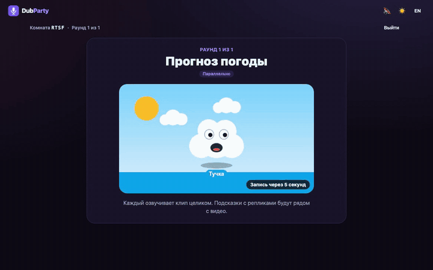
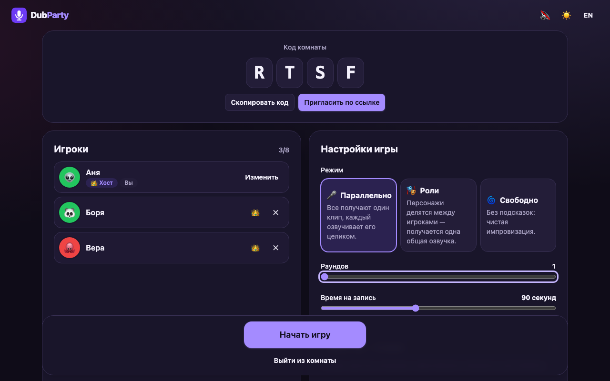
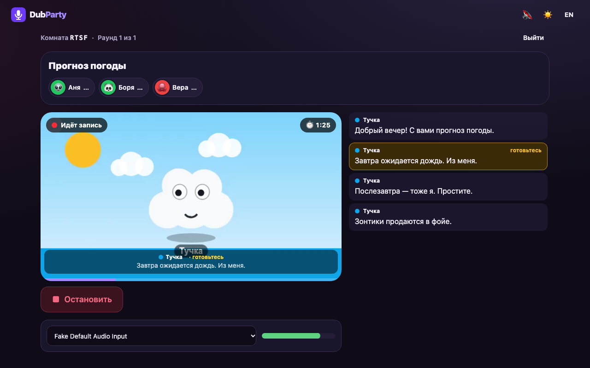
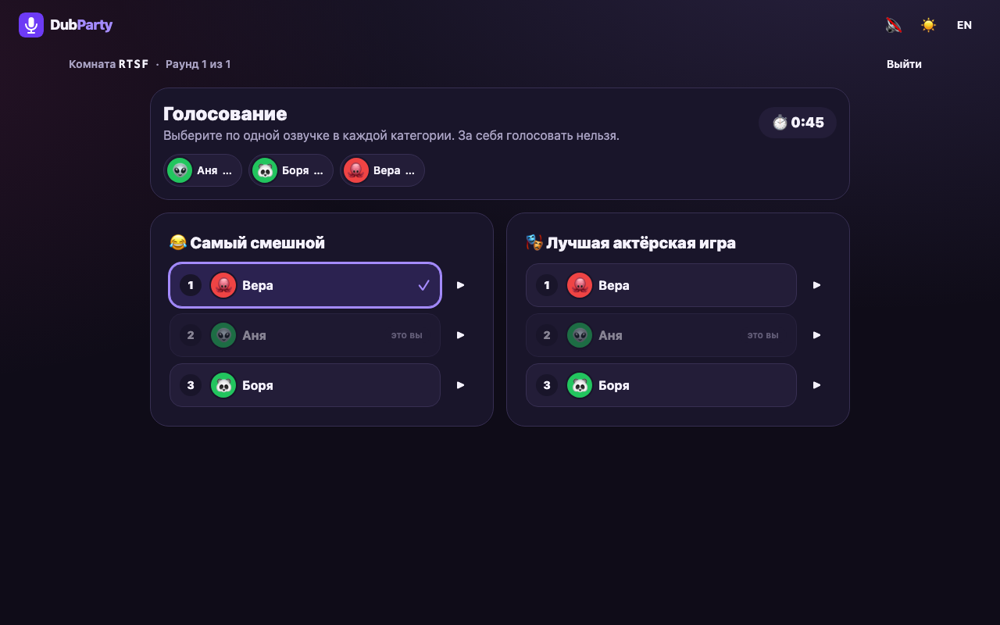
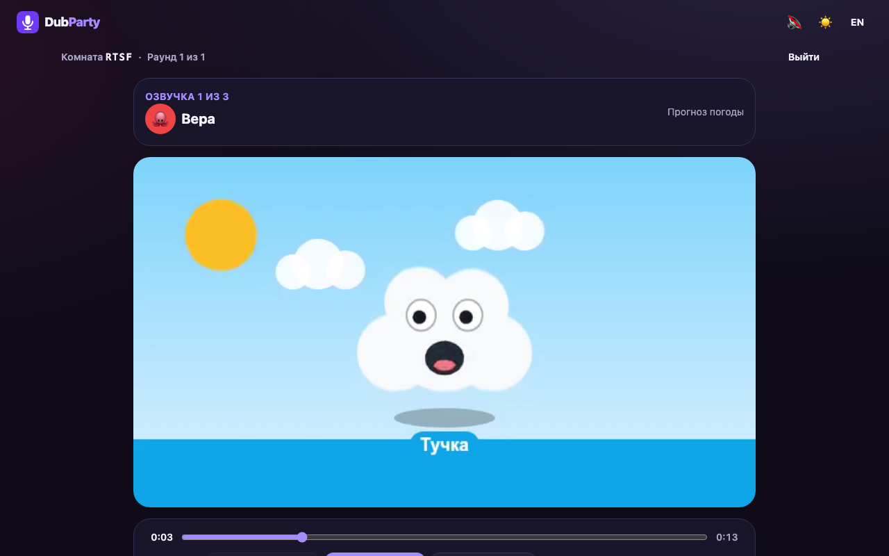
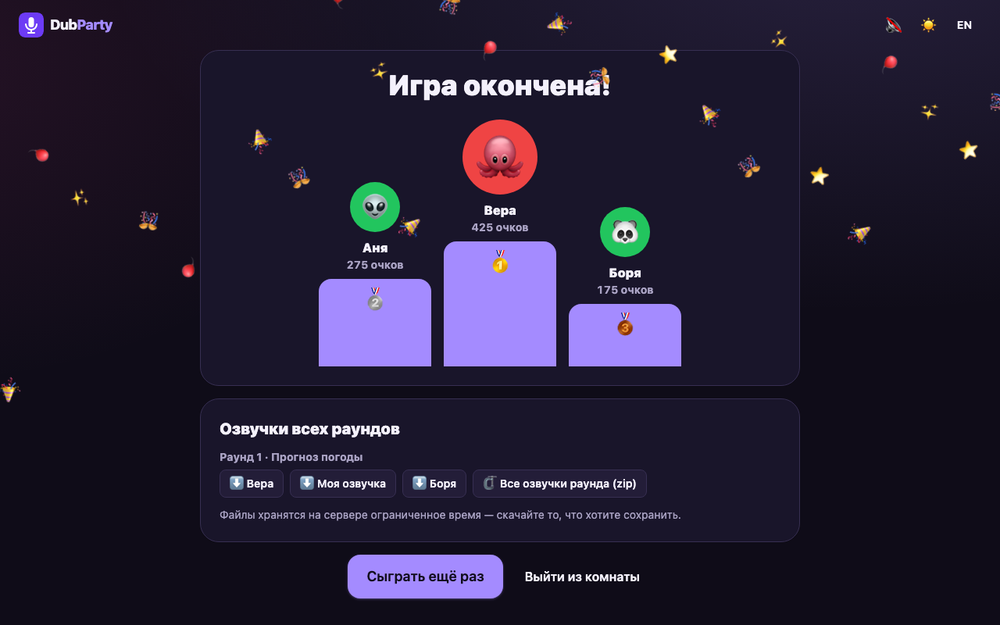
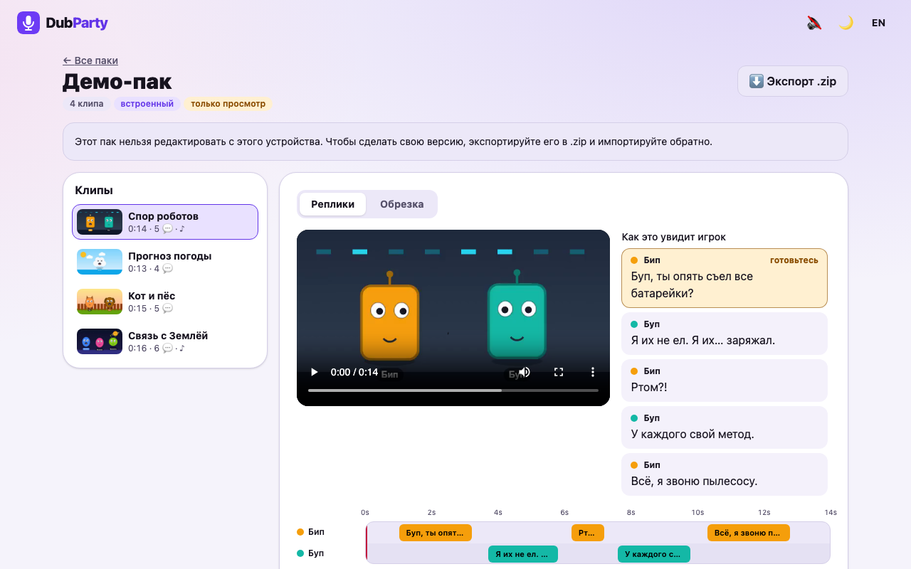

# DubParty

Браузерная пати-игра для компании: все получают клип без звука, переозвучивают его своим голосом, потом вместе смотрят, что получилось, и голосуют за лучших. Без регистрации, 2–8 игроков, играть можно с телефона.



## Возможности

- **Комнаты по коду.** Четыре буквы или ссылка-приглашение. Хост меняет настройки, исключает игроков и передаёт свои права. После обновления страницы или обрыва сети игрок возвращается в ту же комнату.
- **Три режима.** «Параллельно» — каждый озвучивает клип целиком. «Роли» — персонажи делятся между игроками, получается одна общая озвучка. «Свободно» — без подсказок.
- **Запись синхронно с видео.** Отсчёт 3-2-1, подсветка текущей реплики, перезапись сколько угодно раз, прослушивание перед отправкой.
- **Шесть голосовых эффектов.** Выше, ниже, робот, эхо, рация, гелий — слышны при прослушивании и попадают в итоговое видео.
- **Общий просмотр.** Озвучки идут у всех одновременно; паузой и перемоткой управляет хост.
- **Голосование и очки.** Категории «самый смешной» и «лучшая актёрская игра», за себя голосовать нельзя. Таблица лидеров после раунда и подиум в конце.
- **Экспорт.** Игрок скачивает mp4 со своей озвучкой, хост — любую озвучку или весь раунд архивом.
- **Паки клипов.** Встроенный демо-пак и редактор: загрузка видео, обрезка, реплики на таймлайне, импорт и экспорт в `.zip`.
- **Интерфейс.** Тёмная и светлая темы, русский и английский языки, вёрстка под телефон, управление с клавиатуры.

| Лобби | Запись | Голосование |
| --- | --- | --- |
|  |  |  |

| Общий просмотр | Итоги | Редактор паков |
| --- | --- | --- |
|  |  |  |

## Быстрый старт

Нужны Node.js 22.12 или новее и pnpm 9. ffmpeg ставить не нужно: его бинарники приходят вместе с npm-пакетами.

```bash
pnpm install
```

```bash
pnpm dev
```

Игра откроется на http://localhost:5173. При первом запуске сервер около десяти секунд готовит демо-пак.

Чтобы проверить игру в одиночку, откройте её в нескольких окнах: обычном, приватном и в другом браузере. В одном браузере без приватного режима окна делят общую сессию.

### Игра с телефона

Браузеры дают доступ к микрофону только по HTTPS или на `localhost`, поэтому адрес вида `http://192.168.x.x:5173` с телефона не сработает. Два способа:

- **Самоподписанный сертификат.** `pnpm dev:https`, затем откройте `https://<IP компьютера>:5173` и примите предупреждение браузера.
- **Cloudflare Tunnel.** Даёт публичный HTTPS-адрес без настройки роутера — см. ниже.

### Публичный доступ через Cloudflare Tunnel

Установите [`cloudflared`](https://developers.cloudflare.com/cloudflare-one/connections/connect-networks/downloads/) и запустите игру в продакшен-режиме:

```bash
pnpm build
```

```bash
TRUST_PROXY=true pnpm start
```

В другом терминале:

```bash
cloudflared tunnel --url http://localhost:3001
```

Команда напечатает адрес вида `https://….trycloudflare.com` — его и раздайте друзьям. Туннель можно направить и на dev-сервер (`--url http://localhost:5173`): домен `trycloudflare.com` уже разрешён в настройках Vite.

## Продакшен

### Docker

```bash
docker compose up --build
```

Игра будет на http://localhost:3001. База и файлы лежат в томе `dubparty-data`. Настройки берутся из переменных окружения или файла `.env` рядом с `docker-compose.yml`.

### Без Docker

```bash
pnpm build
```

```bash
pnpm start
```

Один процесс отдаёт и API, и собранный клиент на порту `PORT` (по умолчанию 3001).

### Fly.io

В репозитории лежит готовый `fly.toml`.

```bash
fly launch --copy-config --no-deploy
```

```bash
fly volumes create dubparty_data --size 3
```

```bash
fly deploy
```

### Render

`render.yaml` описывает веб-сервис на Docker с диском. В панели Render выберите **New → Blueprint** и укажите репозиторий.

### Что важно при любом деплое

- **Один экземпляр.** Комнаты живут в памяти процесса. Второй экземпляр или усыпление машины ломают идущие игры, а перезапуск сервера их обрывает.
- **`TRUST_PROXY=true` за прокси.** Иначе ограничение частоты запросов увидит всех игроков как один адрес.
- **Постоянный том на `/data`.** Там SQLite и файлы; без него после перезапуска пропадут пользовательские паки.
- **HTTPS обязателен** — без него браузер не даст микрофон.

## Конфигурация

Все параметры — в [`.env.example`](.env.example). Основные:

| Переменная | По умолчанию | Назначение |
| --- | --- | --- |
| `PORT`, `HOST` | `3001`, `0.0.0.0` | Адрес сервера |
| `TRUST_PROXY` | `false` | Доверять `X-Forwarded-*` |
| `CORS_ORIGINS` | пусто | Разрешённые origin через запятую, если клиент на другом домене |
| `DATA_DIR`, `STORAGE_DIR` | `./data`, `./storage` | SQLite и файлы |
| `STORAGE_DRIVER` | `local` | `local` или `s3` |
| `S3_*` | — | Параметры S3-совместимого хранилища |
| `FFMPEG_PATH`, `FFPROBE_PATH` | пусто | Свои бинарники вместо поставляемых с npm |
| `FFMPEG_CONCURRENCY` | `2` | Сколько задач ffmpeg выполнять одновременно |
| `ROOM_TTL_HOURS` | `6` | Через сколько часов после конца игры удалять комнату и файлы |
| `ROOM_IDLE_HOURS` | `12` | То же для заброшенной комнаты |
| `MAX_ROOMS`, `MAX_ROOM_FILES`, `MAX_ROOM_MB` | `500`, `600`, `2048` | Лимиты |
| `HTTP_RATE_LIMIT`, `UPLOAD_RATE_LIMIT` | `600`, `60` | Запросов и загрузок в минуту с одного адреса |

Некорректные значения сервер отклоняет при старте с понятным сообщением.

## Формат паков

Пак — это zip-архив с файлом `pack.json` в корне и медиафайлами, на которые он ссылается. Схема описана в zod: [`packages/shared/src/schemas.ts`](packages/shared/src/schemas.ts), `packManifestSchema`.

```jsonc
{
  "formatVersion": 1,
  "id": "my-pack",
  "title": "Мой пак",
  "description": "Необязательное описание",
  "author": "Кто собрал",
  "language": "ru",
  "license": "CC0-1.0",
  "clips": [
    {
      "id": "robots",
      "title": "Спор роботов",
      "video": "clips/robots/video.mp4",
      "music": "clips/robots/music.m4a",
      "durationMs": 14000,
      "characters": [
        { "id": "beep", "name": "Бип", "color": "#f59e0b" },
        { "id": "boop", "name": "Буп", "color": "#14b8a6" }
      ],
      "lines": [
        { "id": "l1", "characterId": "beep", "startMs": 1000, "endMs": 3200, "text": "Буп, ты опять съел все батарейки?" }
      ],
      "attribution": "Источник и лицензия клипа"
    }
  ]
}
```

| Поле | Правила |
| --- | --- |
| `formatVersion` | Всегда `1` |
| `id`, идентификаторы клипов, персонажей и реплик | Латиница, цифры, `_` и `-`, до 40 символов; уникальны в своей области |
| `video` | Путь внутри архива. MP4, MOV или WebM. **Звук видео при импорте отбрасывается** |
| `music` | Необязательно. Дорожка, которая остаётся слышна во время озвучки и попадает в итог |
| `durationMs` | От 2 до 60 секунд |
| `characters` | От 1 до 8 |
| `lines` | До 200; `startMs < endMs`, персонаж должен существовать, реплика не выходит за конец клипа |

Пути в архиве — только относительные, без `..`. При импорте сервер достаёт из архива лишь файлы, названные в `pack.json`, проверяет каждый по сигнатуре и через ffprobe и перекодирует в единый формат (H.264 до 720p, 30 кадров/с).

Встроенные паки пересобираются командой `pnpm demo:generate`: скрипт рисует анимации на canvas и синтезирует музыку, поэтому всё содержимое можно свободно распространять (CC0).

## Архитектура

```
apps/client      React + Vite + Tailwind, Zustand, i18next
apps/server      Fastify + Socket.IO, SQLite (Drizzle), ffmpeg (fluent-ffmpeg)
packages/shared  zod-схемы, типы событий, подсчёт очков, роли, математика синхронизации, описание эффектов
e2e              Playwright: Chromium и WebKit
```

**Сервер — единственный авторитет.** Фазы игры, таймеры, распределение ролей, приём голосов и подсчёт очков живут в `apps/server/src/game`. Клиент получает снапшот состояния и присылает намерения; каждое событие проходит проверку zod-схемой, ограничение частоты и проверку прав. Чужие голоса и записи до нужной фазы клиенту не отдаются.

**Фазы:** лобби → заставка → запись → обработка → общий просмотр → голосование → итоги → следующий раунд или финал.

**Путь дубля:**

1. Клиент одним обработчиком запускает запись и `video.play()`, затем всю запись раз в 200 мс замеряет разницу «время видео − время записи». Смещение дубля — медиана этих замеров.
2. Дубль уходит на сервер по HTTP вместе со смещением и выбранным эффектом.
3. ffmpeg приводит дорожку к шкале времени клипа (задержка или обрезка начала), накладывает эффект, в режиме ролей оставляет только окна реплик игрока.
4. После записи сервер собирает готовое видео: картинка копируется без перекодирования, к ней сводятся музыка и голоса.

Благодаря шагу 4 при общем просмотре играет один файл, и рассинхрон голоса с картинкой внутри него невозможен. Этот же файл отдаётся на скачивание.

**Общий просмотр.** Сервер хранит «позицию воспроизведения в такой-то момент своего времени». Клиент оценивает сдвиг своих часов (серия замеров, берётся замер с наименьшей задержкой сети) и подгоняет плеер: отклонение до 40 мс не трогает, до 150 мс догоняет скоростью воспроизведения, больше — прыжком.

**Эффекты** описаны один раз в [`packages/shared/src/effects.ts`](packages/shared/src/effects.ts). Из этого описания строятся и граф Web Audio для прослушивания, и фильтры ffmpeg для итогового файла.

**Хранение.** SQLite держит паки и учёт комнат. Файлы идут через `StorageAdapter` — локальный диск или S3-совместимое хранилище.

### Отступления от исходного плана

- **Twitch убран.** Интеграция с чатом была реализована и удалена по решению заказчика. Настройка «Скрыть код комнаты» осталась.
- **Safari записывает в WAV.** `MediaRecorder` в WebKit в калибровочных замерах терял начало записи, поэтому там дубль пишется через AudioWorklet в WAV. Файл получается крупнее: около 6 МБ на минуту.
- **Загрузки идут сырым телом запроса,** а не multipart — так сервер считает байты на лету и обрывает слишком большой файл.
- **Музыка клипа хранится звуковой дорожкой самого видео;** в `pack.json` она остаётся отдельным файлом.
- **Эффекты совпадают по параметрам, но не побитово:** сдвиг высоты тона в браузере и в ffmpeg считают разные алгоритмы.
- **Исходное видео для клипа может быть длиннее 60 секунд** (до 10 минут): его обрезают в редакторе. Лимит 60 секунд действует на готовый клип.

## Тесты и качество

```bash
pnpm check
```

Запускает линтер, проверку типов и юнит-тесты. E2E идут против продакшен-сборки:

```bash
pnpm build
```

```bash
pnpm e2e
```

| Что проверяется | Как |
| --- | --- |
| Фазы, очки, голоса, роли, лимиты, переподключение | Юнит-тесты игровой логики с подставными таймерами |
| Сокеты и HTTP | Интеграционные тесты на живом сервере: валидация, права, ограничение частоты, Range, очистка |
| ffmpeg | Выравнивание дубля, эффекты, окна реплик, сборка видео — на реальном ffmpeg |
| Паки | Загрузка, обрезка, экспорт и импорт, подмена файлов и путей |
| Полный цикл на трёх игроков | Playwright, Chromium и WebKit |
| Синхронизация записи | Калибровочный клип со щелчками: звук клипа заворачивается в «микрофон», положение щелчков сверяется с эталоном |
| Доступность | axe (WCAG 2.1 A/AA) на основных экранах в обеих темах, сценарий с клавиатуры |

Измеренные значения на машине разработки: ошибка выравнивания записи 1–11 мс в Chromium и 7 мс в WebKit при допуске 50 мс; рассинхрон общего просмотра 3–25 мс при допуске 150 мс; серверное выравнивание точнее 3 мс.

Скриншоты и демо-запись в `docs/` обновляются командой `pnpm screenshots` при запущенном сервере.

## Что не проверено

- **Реальные iPhone и Safari.** Проверялся движок WebKit из Playwright на macOS. На настоящем устройстве возможны отличия в автозапуске звука и задержке микрофона.
- **Задержка настоящего микрофона.** Тест синхронизации подаёт в запись звук клипа программно. Задержку конкретной гарнитуры (особенно Bluetooth) браузер сообщает не всегда, и она попадёт в запись.
- **Замер синхронизации в WebKit шумит.** Примерно в одном прогоне из восьми тестовый стенд давал выброс около 250 мс; тесту разрешены две повторные попытки. Отличить ошибку стенда от поведения WebKit не удалось.
- **Нагрузка.** Сервер не проверялся на большом числе одновременных комнат.

## Лицензии

Клипы и музыка демо-пака сгенерированы для этого проекта и распространяются на условиях CC0.
